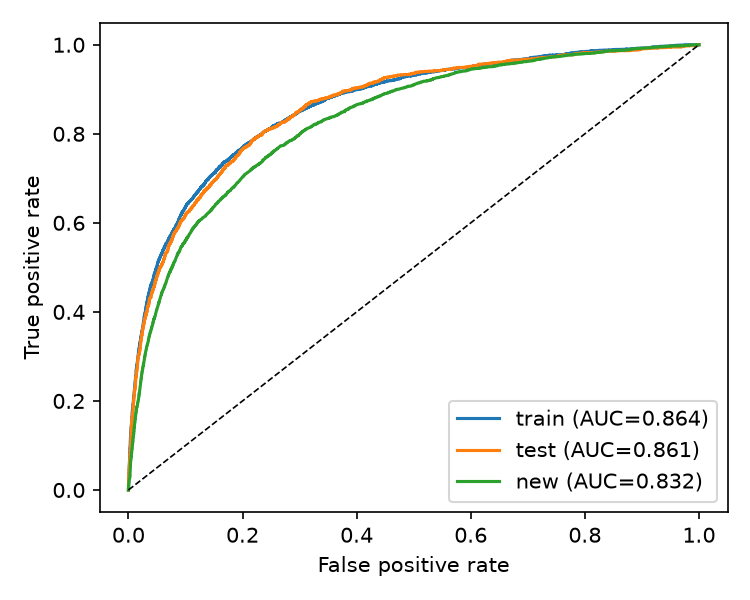
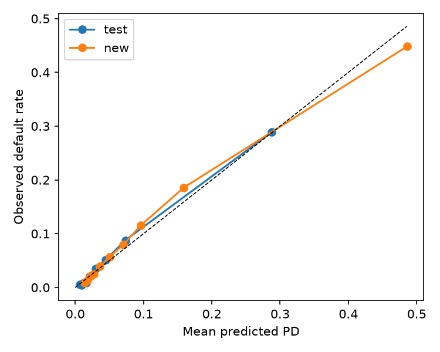
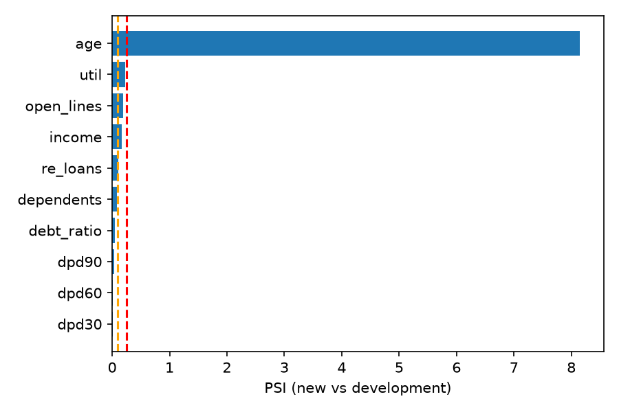

# Credit-Risk Scorecard with Drift Monitoring

An end-to-end probability-of-default (PD) model on the Kaggle *Give Me Some Credit*
dataset, followed by a monitoring layer that checks whether the model still works on a
newer, shifted population.

**Headline:** WoE logistic regression reaches a test Gini of about 0.72 with no
overfitting. On a deliberately shifted younger population (score PSI 1.35), Gini falls
by 5.7 points and overall calibration looks fine, but decile-level calibration reveals
under-prediction in the middle-to-high risk bands.

## Problem
Predict whether a borrower becomes seriously delinquent (90+ days past due) within two
years, using a transparent WoE-binned logistic regression, then monitor it the way a
model-risk team would.

## Data
- Source: Kaggle, *Give Me Some Credit* (`cs-training.csv`), 150,000 borrowers, 10 features.
- Put the file at `data/cs-training.csv` (not committed; see Kaggle for the terms).
- After cleaning: 149,999 rows, default rate about 6.7% (imbalanced).

## Method
1. **Cleaning:** removed impossible ages; capped delinquency counts at 13 (96/98 are
   data-entry codes); kept missing income and dependents as their own "Missing" bin
   instead of imputing; outliers are absorbed by quantile binning.
2. **Class imbalance:** stratified train/test split so the default share matches in both;
   no resampling, since it would distort predicted PDs and break calibration. Evaluation
   uses rank-based metrics (AUC, Gini, KS) plus an explicit calibration check.
3. **Features:** decile or hand-picked bins; WoE = ln(%bad / %good) and IV, fitted on
   training data only; variables with IV < 0.02 dropped.
4. **Model:** `statsmodels` logistic regression on WoE features. Features are pruned for
   VIF > 5 and for wrong-sign coefficients (all must be positive, since higher WoE = riskier).
5. **Metrics:** AUC, Gini (= 2 x AUC - 1), KS on train and held-out test.
6. **Monitoring:** both scenarios train on an "old" sample and score a "new" one.
   - `control`: old = first 70% of rows, new = last 30% (no real drift expected).
   - `age_shift`: old = age 45 and over, new = under 45 (a simulated drift).
   PSI is computed on the score and every input, Gini is compared, and calibration is
   checked by predicted-PD decile.

## Results

| Scenario | Train Gini | Test Gini | New Gini | Score PSI | Mean PD (new) | Observed (new) |
|---|---|---|---|---|---|---|
| control | 0.710 | 0.707 | 0.720 | 0.000 | 6.61% | 6.71% |
| age_shift | 0.727 | 0.721 | 0.664 | 1.350 | 9.78% | 9.91% |

- **Strongest predictors (IV, age_shift development sample):** revolving utilisation (1.12),
  90+ days late (0.88), 30-59 days late (0.86), 60-89 days late (0.69), age (0.25).
- **No overfitting:** train and test Gini differ by about 0.5 points in both scenarios.
- **Control is stable:** PSI is about 0 and Gini on the new sample matches the test sample.
- **Age shift:** the younger population defaults at about 9.9% versus 5.2% in development.
  Gini falls from 0.721 to 0.664 (KS 0.569 to 0.507), and score PSI of 1.35 is far above the
  0.25 threshold.
- **Calibration:** overall predicted PD (9.78%) is close to observed (9.91%), but only because
  errors offset. By decile, the model over-predicts the lowest four deciles, under-predicts
  deciles 6-9 (e.g. 16.0% predicted vs 18.6% observed in decile 9), and over-predicts the
  riskiest decile (48.6% vs 44.8%).
- **Conclusion:** the shift is real and measurable, and the model ranks risk less well on
  the new population. Recommended action: recalibrate by risk band, re-bin age on the
  younger population, and keep monitoring; redevelop if the Gini drop persists.





## Limitations
- The dataset has no time column, so "old vs new" is a proxy; the age split is a stress
  test, not a real out-of-time sample.
- **The age PSI (8.15) is inflated by construction:** age bins were built only from
  customers 45 and over, so every younger customer falls into the lowest age bin. This
  also means age cannot rank-order the under-45s, which explains part of the Gini drop.
- Some bins are only weakly monotonic (debt ratio, open credit lines, real-estate loans),
  and `re_loans` has low IV (0.024); a stricter binning and selection pass could improve
  stability.
- Single snapshot, no reject inference, no macroeconomic variables, no fairness analysis.
- Age is a model input here for demonstration; its use may be restricted in production.
- No recalibration step is implemented; an intercept or band-level adjustment is the
  natural extension.

## Run
```bash
python3 -m venv .venv && source .venv/bin/activate
pip install -r requirements.txt
python scorecard.py --data data/cs-training.csv
```
